<p align="center">
  <a href="https://www.npmjs.com/package/dexe-mcp">
    
  </a>
</p>

<p align="center">
  <a href="https://www.npmjs.com/package/dexe-mcp"></a>
  <a href="https://nodejs.org"></a>
  <a href="https://github.com/edward-arinin-web-dev/dexe-mcp/blob/main/LICENSE"></a>
  <a href="https://modelcontextprotocol.io"></a>
</p>

# dexe-mcp

An MCP (Model Context Protocol) server for [DeXe Protocol](https://dexe.io) governance on BNB Chain, with an additional generic surface for OpenZeppelin and Compound-Bravo Governor DAOs (Uniswap, Compound, Optimism).

It exposes 170 typed tools in 19 groups: DAO deployment, all 33 DeXe proposal types, voting, delegation, execution, OTC token sales, treasury and subgraph reads, one-call DAO reporting, IPFS metadata, transaction simulation, multi-agent orchestration, and diagnostics. Any MCP client that can launch a local command can use it — Claude Code, Claude Desktop, Cursor, Codex CLI, or a custom agent. The package also ships a **read-only edition**, `dexe-mcp-read` (54 tools that only read, on stdio or over HTTP for remote clients) — see [Read-only edition](#read-only-edition-dexe-mcp-read).

Writes are calldata-first: tools return a `{ to, data, value, chainId }` payload for your own wallet to sign. Broadcasting from the server is opt-in, and a human confirms every transaction: through WalletConnect (approved on your phone; no key on disk — the default) or an encrypted local keystore (each batch approved with its password on a local page). A plaintext hot key that signs unattended exists for bots and CI only, testnet by default. [docs/SIGNING.md](./docs/SIGNING.md) explains the modes and what each protects against.

<p align="center">
  <a href="#install-in-claude-code">Install</a> ·
  <a href="#quickstart-other-mcp-clients">Quickstart</a> ·
  <a href="#tool-catalog">Tool catalog</a> ·
  <a href="#environment-variables">Environment</a> ·
  <a href="https://github.com/edward-arinin-web-dev/dexe-mcp/tree/main/docs">Docs</a>
</p>

---

## Install in Claude Code

Two commands, typed inside Claude Code:

```
/plugin marketplace add edward-arinin-web-dev/dexe-mcp
/plugin install dexe@dexe-mcp
```

Then ask:

> "Show the treasury of `0x…` on BSC."

Reads work with no configuration: on-chain data, subgraphs, the DeXe backend, and IPFS all have public defaults, and WalletConnect signing is available immediately (`dexe_wc_connect`). Eight skills install with the plugin — `dexe-setup`, `dexe-create-dao`, `dexe-create-proposal`, `dexe-vote-execute`, `dexe-otc`, `dexe-staking`, `dexe-report` (zero-config), and `dexe-agent-team` (needs `DEXE_TOOLSETS=core,agents` and hot keys in `DEXE_SIGNER_MODE=unattended`).

To create DAOs or proposals, or to broadcast transactions, run `/dexe-setup` — it walks through the two keys that unlock those paths (a Pinata token for IPFS uploads, a signer) and writes them to the `.env` the server actually loads (`~/.dexe-mcp/.env` for a plugin install).

Using Cursor, Claude Desktop, Codex CLI, another local MCP client, or the terminal? See [docs/INSTALL.md](./docs/INSTALL.md).

## Read-only edition (`dexe-mcp-read`)

A second binary in the same package serves only the 54 tools that read: DAOs, proposals, votes and voters, treasury, members, delegation, validators and experts, token sales, staking, protocol statistics, and external Governors. It cannot sign, send, upload or build transactions — that code is not even loaded into its process — and it keeps nothing between calls. It reads with zero configuration, and ignores and drops any signing or upload key it finds in a shared `.env`.

```bash
claude mcp add dexe-read -- npx -y -p dexe-mcp dexe-mcp-read      # Claude Code
```

```json
{ "mcpServers": { "dexe-read": { "command": "npx", "args": ["-y", "-p", "dexe-mcp", "dexe-mcp-read"] } } }
```

`dexe-mcp-read serve-http` serves the same tools over MCP Streamable HTTP for remote clients (Claude.ai custom connectors, ChatGPT developer mode); it ships as a Docker image recipe and is pre-release. Operators: [docs/REMOTE.md](./docs/REMOTE.md).

## Quickstart (other MCP clients)

Reads need no environment at all. The steps below set up uploads and signing.

**Wizard path:**

```bash
npx -y dexe-mcp@latest --version   # what you are about to run
npx -y dexe-mcp@latest init        # interactive setup: network, Pinata, signer mode
npx -y dexe-mcp@latest doctor      # verifies RPC, Pinata, IPFS gateway, subgraph
```

`--help` and `--version` print and exit without loading any environment. `init` writes `~/.dexe-mcp/.env` (a source checkout writes the repo-root `.env`) and prints a client-config snippet to paste. `doctor` checks every recognized `DEXE_*` variable and reports pass/warn/fail with remediation hints; **warnings are normal on a zero-config install** and it exits `0` — pass `--strict` (or set `DEXE_DOCTOR_STRICT=1`) to make warnings exit `1` in CI, and expect `2` on a real failure. Full runbook: [docs/SETUP.md](./docs/SETUP.md); check reference: [docs/DOCTOR.md](./docs/DOCTOR.md); upgrade notes: [docs/MIGRATION.md](./docs/MIGRATION.md).

Already installed globally? Use `dexe-mcp init` instead — **do not mix the two.** A global install shadows `npx dexe-mcp@<version>`, which then silently runs the old code ([docs/INSTALL.md](./docs/INSTALL.md)).

**Manual path** — register with your MCP client (`.mcp.json`, `claude_desktop_config.json`, Cursor settings):

```json
{
  "mcpServers": {
    "dexe": {
      "command": "npx",
      "args": ["-y", "dexe-mcp@latest"]
    }
  }
}
```

With a global install, the same block is `{ "command": "dexe-mcp" }`. Add an `env` block only if you want to override the defaults:

```json
{
  "mcpServers": {
    "dexe": {
      "command": "dexe-mcp",
      "env": {
        "DEXE_RPC_URL_MAINNET": "https://bsc-dataseed.bnbchain.org"
      }
    }
  }
}
```

The `env` block is optional — without it the server falls back to a public BSC RPC, which is rate-limited and suitable for evaluation; set your own endpoint for production use.

> **Windows:** if your MCP client can't resolve the `dexe-mcp` shim on PATH, point it at the script directly:
> `{ "command": "node", "args": ["<npm root -g>/dexe-mcp/dist/index.js"] }`

**Example calls** (all four are in the default profile — no `DEXE_TOOLSETS`, no env):

```jsonc
// The whole DAO in one call: identity, treasury, members, delegation,
// turnout, and everything with a deadline
dexe_dao_report({ govPool: "0x...", chainId: 56 })

// ...and on the next run, only what moved since the previous one
dexe_dao_report({ govPool: "0x...", chainId: 56, since: "last" })

// Enumerate every proposal type the server can build
dexe_proposal_catalog({ category: "all", implementedOnly: true })

// Create a proposal of ANY catalog type — proposalType + params
dexe_proposal_create({
  govPool:      "0x...",
  title:        "Pay the audit invoice",
  proposalType: "token_transfer",
  params:       { token: "0x...", recipient: "0x...", amount: "1000.0" }
})
```

`dexe_proposal_create` covers every on-chain catalog type; the single-purpose `dexe_proposal_build_*` builders (raw calldata, one tool per type) need `DEXE_TOOLSETS=core,proposals`.

Each write tool returns a `TxPayload` you pass to your wallet. To let the server broadcast instead, connect a wallet over WalletConnect (`dexe_wc_connect`), or create an encrypted key with `npx dexe-mcp key create` and set `DEXE_SIGNER_MODE=keystore` — each batch (and each off-chain login or Safe signature) then opens a local approval page that asks for its password, or you approve in a terminal with `npx dexe-mcp approve`. That enables the composite flows `dexe_proposal_create`, `dexe_proposal_vote_and_execute`, and `dexe_tx_send`. A hot `DEXE_PRIVATE_KEY` signs only with `DEXE_SIGNER_MODE=unattended` (bots, CI); see [docs/SIGNING.md](./docs/SIGNING.md).

## Requirements

- Node.js ≥ 20.12 with a working `npm` (`process.loadEnvFile`, used to read `.env`, needs 20.12+). Check with `node -v`.
- Git — only for the optional dev toolset (`dexe_compile` / `dexe_test` / `dexe_lint`), which shallow-clones DeXe-Protocol on first use. Set `DEXE_PROTOCOL_PATH` to use an existing checkout. Reads, builders, and deploys do not use it.

## Features

- DeXe governance coverage: the 33 proposal types (24 external, 4 internal validator, 5 off-chain), validator chamber, expert delegation, multi-tier OTC sales with merkle whitelists.
- Calldata-first key model: no private key is required for any build tool. Broadcasting is a separate, explicit opt-in.
- Zero-config reads: public RPC, subgraph, backend, and IPFS gateway defaults let read tools work out of the box — including `dexe_dao_report`, which returns a whole DAO (identity, treasury, membership, delegation, turnout, deadlines) in one call, and can diff itself against its own previous run. [docs/REPORTING.md](./docs/REPORTING.md)
- External Governor support: 18 `dexe_gov_*` tools read, build, simulate, and decode against OpenZeppelin and Bravo Governors; new DAOs are a config entry.
- Multi-agent orchestration: run several wallets as personas against one DAO. `signerKey` on the write composites (`dexe_dao_create`, `dexe_proposal_create`, `dexe_proposal_vote_and_execute`, `dexe_tx_send`, the OTC buyer composites) chooses which keyring wallet signs; `dexe_agents_fund` previews a funding plan and only moves value on `confirm: true`, under an enforced per-agent cap and a rolling 24-hour spend budget; `dexe_agents_ledger` reports which persona did what and what it cost. **A fleet of hot keys sitting in `.env` is a loaded gun** — read [docs/AGENTS.md](./docs/AGENTS.md) for the safety model, what enforces versus what only advises, and the testnet-first workflow, before pointing personas at a DAO that holds real money.
- Tested on-chain: a 69-scenario multi-agent harness exercises the builders against BSC-testnet fixture DAOs — build-only checks for all proposal types, full propose → vote → execute lifecycles for the broadcast paths.
- MIT-licensed, no telemetry, no hosted dependency — requests go only to endpoints you configure.

## Example applications

Verified, prompt-level scenarios live in **[docs/USE_CASES.md](https://github.com/edward-arinin-web-dev/dexe-mcp/blob/main/docs/USE_CASES.md)** — each with the exact tools it exercises and on-chain evidence. Highlights:

- **Basics** — create a DAO with its own token in one call; propose → vote → execute; join an existing DAO.
- **Q&A over live data** — "does DAO X have validators?", whale maps, TVL charts, delegation graphs, per-proposal voter lists. _(Since v0.31.0 the reporting reads are in the default profile and need no keys: `dexe_dao_report`, `dexe_graph_query`, `dexe_graph_schema`, DAO list/members/stats, token holders, delegation map. `dexe_dao_report`'s `turnout` section already carries per-proposal voter counts. The long-tail reads — named voter lists (`dexe_proposal_voters`), validator rosters, per-user activity, local experts, protocol stats, NFTs, inbox/forecast/risk — still live in the `read` profile: set `DEXE_TOOLSETS=core,read` (or `full`), or ask `dexe_context` which sets are off and how to enable them.)_
- **Automation** — pair reads with your agent's scheduler (`/loop`, `/schedule`): a scheduled `dexe_dao_report` with `since: "last"` reports only what moved since its own previous run, plus proposal watchdogs, daily governance digests (`dexe_user_inbox`), quorum trackers, treasury monitors, policy-based delegate agents.
- **Analysis** — decode + risk-assess any proposal (quorum safety, treasury at risk, who profits); due-diligence a DAO before buying in; simulate before broadcasting.
- **Advanced ops** — make the DAO call ANY external contract (`custom_abi`), OTC sales, cross-DAO delegation (one DAO voting inside another — live on mainnet), external Governor DAOs, Safe multisig.

## Tool catalog

170 tools in 19 groups. Full per-tool reference with required env vars: [docs/TOOLS.md](https://github.com/edward-arinin-web-dev/dexe-mcp/blob/main/docs/TOOLS.md).

**A default session loads the `core` profile — 46 tools, ~94 KB of `tools/list`.** That is orientation (`dexe_context`, `dexe_write_context`, `dexe_guide`, `dexe_doctor`), the one-call composites (`dexe_dao_create`, `dexe_proposal_create`, `dexe_proposal_vote_and_execute`, the four `dexe_otc_*` composites with the token-sale reads `dexe_read_token_sale_position` / `dexe_read_token_sales`), signing (`dexe_tx_send`, `dexe_tx_approval_status`, WalletConnect, the key vote builders), the IPFS upload trio plus `dexe_ipfs_fetch`, `dexe_dao_info` / `dexe_dao_registry_lookup` / `dexe_dao_predict_addresses`, `dexe_proposal_state` / `_list` / `_catalog`, `dexe_read_treasury` / `_settings`, and the zero-config reporting reads (`dexe_dao_report`, `dexe_graph_query`, `dexe_graph_schema`, DAO list/members/stats, token holders, delegation map). Which profile to run, and what each costs: [docs/PROFILES.md](./docs/PROFILES.md).

Changed in v0.31.0: the ~30 single-purpose `dexe_proposal_build_*` builders are **no longer loaded by default** — `dexe_proposal_create` covers every on-chain catalog type from `proposalType` + `params`, and `dexe_proposal_catalog` still enumerates them. Set `DEXE_TOOLSETS=core,proposals` to restore the pre-0.31 default exactly. Add profiles (`proposals`, `read`, `vote`, `agents`, `governor`, `dev`) or `DEXE_TOOLSETS=full` for everything — see [docs/PROFILES.md](./docs/PROFILES.md). Note before reaching for `full`: it registers all 170, and some hosts (VS Code / GitHub Copilot) cap a chat request at 128 enabled tools per request and reject the session above that; the server prints a startup note when you cross it. Call `dexe_context` first in a session: it returns the active chain, env readiness, which profiles are off and what each unlocks, and DAOs/proposals recorded in prior sessions. Since v0.36.0 the signer, the agent keyring and the Pinata / WalletConnect / Safe posture are `dexe_write_context`.

New in v0.32.0: **`agents`**, a seventh profile for running a multi-persona fleet — `dexe_agents_list` (who is in the keyring, and their balances), `dexe_agents_fund` (top them up, preview-then-confirm, inside the enforced caps), and `dexe_agents_ledger` (who did what, and what it cost). Set `DEXE_TOOLSETS=core,agents` and restart; add `vote` (`core,agents,vote`) when the scenario needs the raw delegation and validator builders. `dexe_agents_list` / `dexe_agents_fund` also remain in `vote`, so an existing `core,vote` session keeps exactly the surface it had. Details and the safety model: [docs/AGENTS.md](./docs/AGENTS.md).

The `Tools` column counts the whole group, not what a default session loads — most groups sit behind a profile. [docs/TOOLS.md](https://github.com/edward-arinin-web-dev/dexe-mcp/blob/main/docs/TOOLS.md) names the profile at the top of every section.

| Group | Tools | Summary |
|-------|-------|---------|
| Dev tooling | 4 | Hardhat lifecycle for the DeXe-Protocol workspace: `dexe_compile`, `_test`, `_coverage`, `_lint`. |
| Contract introspection | 10 | List contracts, fetch ABIs, look up selectors, read NatSpec and source, decode calldata and proposal payloads. |
| DAO reads | 34 | `dexe_dao_report` — one call for a whole DAO (identity, settings, treasury, membership, delegation, experts, validators, proposals, turnout, activity, deadlines) with an optional `since` diff — plus DAO info, proposal state/list/voters, voting power, treasury, settings, validators, staking, distributions, risk assessment, protocol-wide stats, and subgraph queries (DAO list, members, experts, delegation map, user activity, free-form `dexe_graph_query`, live schema introspection via `dexe_graph_schema`). |
| IPFS | 9 | Pinata uploads for files, avatars, and DAO/proposal metadata; metadata updates; JPEG avatar generation; gateway-fallback fetch; local CID computation. |
| DAO deploy | 2 | `dexe_dao_create` (one-call composite with pre-flight revert guards) and `dexe_dao_build_deploy` (full `deployGovPool` struct encoder). |
| Proposal catalog and primitives | 5 | `dexe_proposal_catalog` plus generic `_build_external`, `_build_internal`, `_build_custom_abi`, `_build_offchain`. |
| External proposal wrappers | 20 | Named builders: token transfer/distribution/sale, treasury withdraw, validators, experts, staking tiers, blacklist, profile changes, voting settings, and more. |
| Internal validator wrappers | 4 | Validator-chamber proposals: balances, settings, monthly withdraw, off-chain internal. |
| Off-chain wrappers and auth | 9 | DeXe backend integration: SIWE login, off-chain proposal creation and voting. |
| Vote, stake, delegate, execute, claim builders | 26 | Direct EOA writes on `GovPool` and `Validators`: deposit, vote, delegate, execute, claim, staking, token-sale buy/claim, multicall. |
| Composite signing flows | 12 | `dexe_guide` (call first for any multi-step request), `dexe_proposal_create`, `dexe_proposal_vote_and_execute`, `dexe_tx_send`, `dexe_tx_status`, `dexe_tx_approval_status` (keystore approvals, read-only), `dexe_get_config`, `dexe_context`, `dexe_write_context` (signer, keyring, upload/WalletConnect/Safe posture), plus the agent keyring — `dexe_agents_list`, `dexe_agents_fund`, and `dexe_agents_ledger` (v0.32), which are gated behind the `agents` profile. |
| Merkle utility | 2 | `dexe_merkle_build` and `dexe_merkle_proof`, compatible with OZ `StandardMerkleTree`. |
| OTC composites | 4 | Open a multi-tier sale, read a buyer's position (`dexe_read_token_sale_position`), buy (native or with merkle proof), claim vested payouts. [docs/OTC.md](./docs/OTC.md) |
| Safe multisig | 2 | Queue transactions in the Safe Transaction Service instead of broadcasting. [docs/SAFE.md](./docs/SAFE.md) |
| Simulator | 3 | `eth_call` preflight with decoded revert reasons: `_sim_calldata`, `_sim_proposal`, `_sim_buy`. [docs/SIMULATOR.md](./docs/SIMULATOR.md) |
| Multi-DAO inbox + forecast | 2 | Pending items across N DAOs (`dexe_user_inbox`) and quorum-projection pass-rate forecasts. [docs/INBOX.md](./docs/INBOX.md) |
| External Governor DAOs | 18 | `dexe_gov_*`: family-aware propose/vote/queue/execute/delegate, dry-runs, vote receipts, decoding for OZ and Bravo Governors. [docs/GOVERNOR.md](./docs/GOVERNOR.md) |
| WalletConnect | 3 | `dexe_wc_connect` (pairing QR), `dexe_wc_status`, `dexe_wc_disconnect`. Transactions sign on your phone. [docs/WALLETCONNECT.md](./docs/WALLETCONNECT.md) |
| Diagnostics | 1 | `dexe_doctor`: runs reachability checks across the configured environment and prints remediation hints. |

## Environment variables

No variable is required to start the server; tools that need a missing one fail with a message naming what to set. Full matrix: [docs/ENVIRONMENT.md](./docs/ENVIRONMENT.md).

| Variable | Used for | Notes |
|----------|----------|-------|
| `DEXE_RPC_URL_MAINNET` / `DEXE_RPC_URL_TESTNET` / `DEXE_RPC_URL_<chainId>` | all on-chain tools | Per-chain JSON-RPC endpoints. Without any, a public BSC RPC is used (rate-limited). `DEXE_RPC_URL` still works as a legacy single-chain alias. |
| `DEXE_DEFAULT_CHAIN_ID` | chain selection | Default `56` (BSC mainnet); `97` for testnet. |
| `DEXE_DISABLE_PUBLIC_RPC` | hardening | Set `1` to turn off the public RPC fallback — BSC, and the archive-capable Ethereum/Optimism fallback the `dexe_gov_*` tools use. |
| `DEXE_PINATA_JWT` | IPFS uploads | Required to **broadcast** a DAO/proposal creation (metadata pinning). Previews and `dryRun` need no key — they compute the same CID offline. |
| `DEXE_IPFS_GATEWAY` | IPFS reads | Dedicated gateway (Pinata, Filebase, self-hosted). Without one, public gateways (ipfs.io, dweb.link) are used. |
| `DEXE_PINATA_GATEWAY_TOKEN` | IPFS reads | Gateway key for restricted Pinata dedicated gateways. |
| `DEXE_IPFS_DISABLE_PUBLIC_FALLBACK` | hardening | Set `1` to disable public gateway fallback. |
| `DEXE_WALLETCONNECT_PROJECT_ID` | WalletConnect signing | A shared default ships; set your own project ID for production use. |
| `DEXE_SIGNER_MODE` | signing | `walletconnect` (default) · `keystore` (encrypted key, password per batch on a local page — `npx dexe-mcp key create`) · `readonly` · `unattended` (hot keys, no confirmation, `DEXE_UNATTENDED_CHAINS` only, default 97). See [docs/SIGNING.md](./docs/SIGNING.md). |
| `DEXE_PRIVATE_KEY` | unattended mode | Hot-key signing, read only in `DEXE_SIGNER_MODE=unattended`. With the mode unset, a hot key is ignored (since 1.0.0). Move it into the keystore with `npx dexe-mcp key import --from-env`. |
| `DEXE_TOOLSETS` | tool gating | Comma list of profiles; default `core` (v0.31.0; was `core,proposals`). Valid: `core`, `proposals`, `read`, `vote`, `agents`, `governor`, `dev`, `full`. `agents` (v0.32.0) adds the keyring fleet tools — `DEXE_TOOLSETS=core,agents`. |
| `DEXE_SUBGRAPH_POOLS_URL` / `_VALIDATORS_URL` / `_INTERACTIONS_URL` | subgraph reads | The Graph endpoints; defaults target the decentralized network. |
| `DEXE_GRAPH_API_KEY` | subgraph reads | Only when the URL doesn't embed the key. |
| `DEXE_BACKEND_API_URL` | off-chain proposals | DeXe backend, e.g. `https://api.dexe.io`. |
| `DEXE_STATE_PATH` | persistence | Overrides the session-state file (`~/.dexe-mcp/state.json`). |
| `DEXE_PROTOCOL_PATH` | dev toolset | Existing DeXe-Protocol checkout; disables auto-clone. |
| `DEXE_SAFE_DELEGATECALL` | hardening | Set `block` to refuse Safe `operation: 1` outright. By default a DELEGATECALL needs an explicit `allowDelegateCall: true` on the call. |
| `DEXE_DOCTOR_STRICT` | CI | Set `1` to make `dexe-mcp doctor` exit `1` on warnings (same as `--strict`). |

## Documentation

- [docs/USE_CASES.md](./docs/USE_CASES.md) — verified use-case catalog: what to say to your agent, what happens, on-chain evidence.
- [docs/PLAYBOOK.md](./docs/PLAYBOOK.md) — the AI playbook: intent → exact call, per-type params, error → remedy. Also served as the MCP resource `dexe://playbook`.
- [docs/TOOLS.md](./docs/TOOLS.md) — all 170 tools, grouped, with one-line descriptions, the toolset profile each section needs, and required env vars. Also served as the MCP resource `dexe://tools`.
- [docs/REPORTING.md](./docs/REPORTING.md) — `dexe_dao_report`: the one-call DAO report, its sections, the `since` diff, and running it on a schedule.
- [docs/USAGE.md](./docs/USAGE.md) — worked examples with copy-pasteable JSON.
- [docs/ENVIRONMENT.md](./docs/ENVIRONMENT.md) — full env-var reference and common pitfalls.
- [docs/INSTALL.md](./docs/INSTALL.md) — install instructions per MCP client.
- [docs/PROFILES.md](./docs/PROFILES.md) — which `DEXE_TOOLSETS` profile to run, what each costs in `tools/list`, and the host tool-count cap.
- [docs/SETUP.md](./docs/SETUP.md) / [docs/DOCTOR.md](./docs/DOCTOR.md) — setup wizard and diagnostic reference.
- [docs/AGENTS.md](./docs/AGENTS.md) — multi-persona agent teams: the safety model for a hot-key fleet, the `agents` toolset, funding guards, the run sequence that works on-chain, and the attribution ledger.
- [docs/SKILLS.md](./docs/SKILLS.md) — the Claude Code skills shipped with the package.
- [docs/GRAPH.md](./docs/GRAPH.md) — subgraph entity reference for `dexe_graph_query` (pools / interactions / validators). Also served as the MCP resource `dexe://graph-schema`.
- [docs/GOVERNOR.md](./docs/GOVERNOR.md) — the external OZ/Bravo Governor surface.
- [docs/SIGNING.md](./docs/SIGNING.md) — signer modes (WalletConnect, encrypted keystore, read-only, unattended), the approval page, and the threat model.
- [docs/WALLETCONNECT.md](./docs/WALLETCONNECT.md) — phone-approved signing without a hot key.
- [docs/OTC.md](./docs/OTC.md) — multi-tier OTC sale flows for owners and buyers.
- [docs/PROFILE.md](./docs/PROFILE.md) — DAO profile and avatar pipeline.
- [docs/SIMULATOR.md](./docs/SIMULATOR.md) — preflight simulation with revert decoding.
- [docs/INBOX.md](./docs/INBOX.md) — cross-DAO inbox and proposal forecast.
- [docs/MIGRATION.md](./docs/MIGRATION.md) — per-version upgrade notes.
- [docs/REMOTE.md](./docs/REMOTE.md) — the read-only edition `dexe-mcp-read`: stdio setup, and hosting it over HTTP (`serve-http`, Docker) for remote clients.

## Swarm test harness

[`tests/swarm/`](./tests/swarm) is a multi-agent harness that exercises the tool surface against real BSC-testnet DAOs: 69 JSON scenarios covering delegation chains, the validator chamber, build-only checks for every proposal type, OTC flows, and full broadcast lifecycles. The orchestrator resolves agent wallets and runs each step through an inline ethers dispatcher or the dexe-mcp stdio bridge.

```bash
npm run swarm:preflight                # per-wallet readiness table
npm run swarm:fund -- --confirm        # top up agent wallets from the funder
npm run swarm:run                      # full sweep
npm run swarm:run -- --scenarios=S00-reset --dry-run
```

Setup runbook: [tests/swarm/README.md](./tests/swarm/README.md) · scenario schema: [tests/swarm/scenarios/_schema.md](./tests/swarm/scenarios/_schema.md) · agent prompts: [tests/swarm/prompts/](./tests/swarm/prompts).

## Contributing

```bash
git clone https://github.com/edward-arinin-web-dev/dexe-mcp.git
cd dexe-mcp
npm install
npm run build
npm test
npm run dev          # watch mode
```

Issues, PRs, and proposal-type requests: [GitHub issues](https://github.com/edward-arinin-web-dev/dexe-mcp/issues).

## Security

See [SECURITY.md](./SECURITY.md) for the threat model, policy, and how to report a vulnerability. In short:

- Release tags are GPG-signed; `release.yml` runs `git verify-tag` before publishing. Verify locally with `git verify-tag <tag>` (e.g. `v0.19.0`) after importing the maintainer key.
- npm releases publish with `--provenance`; verify with `npm audit signatures`.
- CI installs strictly from the committed lockfile and fails on drift.
- CodeQL, OSSF Scorecard, and Dependency Review run on PRs and on a schedule.

## License

MIT. See [LICENSE](./LICENSE).

---

<p align="center">
  <sub>Independent open-source integration for the DeXe Protocol governance stack. Not affiliated with DeXe Network.</sub>
</p>
